# Software factory

A small software factory that turns requirements tickets into code with a Claude agent.

The spec is generated via a "grilling" conversation with an agent. The spec is then approved by a human and the code is  generated by the agent. In the end result you get a full app with:

1. Acceptance tests, run against the live service.
2. 100% unit test coverage.
3. Mutation tests: the tests must catch at least 85% of deliberately injected bugs.
4. Static, dependency and secrets scans.

## How it works

```mermaid
flowchart LR
    subgraph spec["1 · Agree the spec"]
        direction LR
        intake["Intake skill<br/>grills you"] --> ticket["ticket.md<br/>(pending)"]
        ticket --> author["Acceptance author<br/>fresh context"]
        author --> tests["Red acceptance<br/>tests"]
        tests --> approve{{"You approve"}}
    end

    subgraph build["2 · Build"]
        direction LR
        next["factory next"] --> worker["Claude worker<br/>sandboxed"]
        worker --> verify{"make verify<br/>+ integrity check"}
        verify -- "red: retry,<br/>up to 3 attempts" --> worker
    end

    approve -- "commit to main" --> next
    verify -- green --> branch["Commit on<br/>factory/#lt;id#gt;"]
    verify -- "out of attempts<br/>or spec defect" --> escalate{{"Escalated<br/>to you"}}
    branch --> merge{{"You review<br/>and merge"}}

    classDef human fill:#fde68a,stroke:#b45309,color:#1f2937
    classDef agent fill:#ddd6fe,stroke:#6d28d9,color:#1f2937
    classDef factory fill:#99f6e4,stroke:#0f766e,color:#1f2937
    classDef artifact fill:#e5e7eb,stroke:#4b5563,color:#1f2937

    class approve,merge,escalate human
    class intake,author,worker agent
    class next,verify factory
    class ticket,tests,branch artifact
```



<sub>🟨 you · 🟪 Claude agent · 🟩 factory and repo gates · ⬜ files and commits</sub>

1. **Intake** (`factory-intake` skill) interviews you one question at a time and writes the target's `docs/design.md` and one pending ticket per feature.
2. **Acceptance-test author** (`factory-acceptance-author` skill) runs in a fresh session with only the ticket and the design sections it names. It writes one test per criterion - at this point it is a failing test.
3. **Build** (`factory next` command) takes the lowest-numbered pending ticket, proves `main` is green and the new tests are red, then gives the worker up to three attempts to make them pass. Each attempt ends with an integrity check and `make verify`, and any failing output is fed into the next attempt.

### What stops the Claude worker from cheating

- **Sealed paths.** The ticket, the acceptance tests, the Makefile, build files, scripts and `.claude/` are sealed. Edit and Write are denied on them, and an integrity check after every attempt fails the run if any sealed file changed, a copied-in test differs, or `.git/` was touched.
- **The judge is the repo, not the agent.** The factory runs `make verify` on the host; the worker only runs `make unit` inside its sandbox.
- **Sandbox.** The worker runs in Claude Code's native sandbox: writes confined to its git worktree, network limited to the Anthropic API plus the pack's hosts (e.g. Maven Central), Bash limited to `make unit` and read-only commands, no git writes, no credentials besides the model's own.
- **Honest outcomes.** A run ends `green`, `escalated`, `spec_defect` (the worker argues a test is wrong, with evidence), `integrity_violation`, `baseline_red`, `ticket_already_green` or `worker_error`. Only `green` commits.

Every run writes `report.json`, `report.md` and a full transcript under `.factory/runs/`, with tokens and cost per attempt.

### Packs

The factory core contains no language-specific code. A language joins through a pack in `packs/<name>/`: a Makefile with `unit`, `acceptance` and `verify` targets, sealed globs, network hosts, worker rules, a coding-standards skill, and optionally an app skeleton. The Java pack ships a Spring Boot skeleton with 100% coverage, mutation testing, ArchUnit rules and static scans already wired into `make verify`.

## Requirements

- macOS or Linux (the native sandbox uses Seatbelt / bubblewrap). Developed on macOS.
- Node 22 (`>=22.13 <23`) and pnpm via corepack.
- git and make.
- A Claude Code login or `ANTHROPIC_API_KEY` for real runs.
- Java pack: the JDK named in the skeleton's `pom.xml` (on macOS under `/Library/Java/JavaVirtualMachines`, elsewhere via `JAVA_HOME`) and Docker for the scans.

## Quickstart

```sh
make install            # pnpm install --frozen-lockfile
make test               # prettier, eslint, tsc, vitest with 100% per-file coverage

# Start a new Java app from the pack skeleton
mkdir ../my-app && git -C ../my-app init
corepack pnpm factory init --repo ../my-app --pack java --skeleton \
  --param package=com.example.myapp --param name=my-app
# review and commit in ../my-app, then:

# in Claude Code, from this repo: run the factory-intake skill for ../my-app,
# then factory-acceptance-author on each ticket

corepack pnpm factory check --repo ../my-app --ticket 01-<id>   # tests are red
corepack pnpm factory next  --repo ../my-app                     # spends API credit
```

Settings (model, attempts, failure-tail length) are in `factory.config.yaml`.

## Limits

- One pack so far (Java).

## Repo map

- `docs/design.md` — the design; tickets reference its sections.
- `docs/tickets/done/` — the tickets the factory itself was built from.
- `src/` — the factory CLI (TypeScript).
- `packs/java/` — the Java pack.
- `.claude/skills/` — the intake and acceptance-author skills, and the Node standards the factory's own code follows.

## License

MIT — see `LICENSE`.